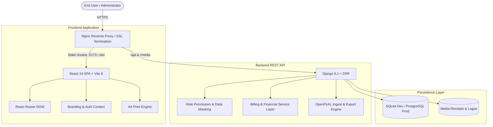

# EduFee Pro — Enterprise Student Fee & Academic Ledger Management System

[](frontend/)
[](backend/)
[-brightgreen?logo=vitest)](backend/)
[](/)
[](/)

> **EduFee Pro** is an enterprise-grade academic billing, student fee accounting, and installment ledger management platform built specifically for colleges, academies, and educational institutions. It delivers real-time financial tracking, WhatsApp groups-style cohort browsing, one-click WhatsApp fee reminders, automated receipt generation, and print-ready 1-page official fee summary certificates.

---

## 🌟 Key Highlights & Capabilities

### 🎓 WhatsApp Groups-Style Cohort Directory
- Visual cards for each academic cohort (e.g., *Degree B.Com*, *Open School Intermediate*).
- Live metrics showing total enrolled students, collection progress bars, and financial collection rates.
- Instant expansion of students enrolled in any batch without heavy page reloads or complex nested pagination.

### 📄 1-Page Official Student Fee Summary Statement
- High-authority, printable fee statement formatted strictly to fit a standard **single A4 sheet**.
- Auto-populates institutional branding (name, logo, address, contact), student profile (name, father's name, admission no, hall ticket no, batch, phone), full multi-year fee breakdown, itemized line items, chronological payment receipts, and authorized stamp/signature blocks.
- One-click trigger from both cohort student listings and 360° student profile ledgers.

### 📊 Real-Time Financial Intelligence & KPI Dashboard
- Instant institutional KPIs: Total Fees Committed, Total Collections, Outstanding Balance, Concessions Granted.
- Visual collection velocity charts, payment mode breakdowns (UPI, Cash, Bank Transfer, Cheque), and recent payment streams.

### 🔒 Role-Based Access Control & Privacy Masking
- Three granular permission profiles:
  - **Super Admin**: Full administrative and financial ledger access.
  - **Accountant**: Billing, collection entry, custom line item adjustments, receipt generation.
  - **Faculty / Read-Only**: View rosters and academic status with automatic masking of sensitive personal data (parent phone numbers and Aadhaar numbers).

### 💬 Direct WhatsApp Notification & Receipt Links
- Encoded one-click WhatsApp message triggers using customizable templates (`{{student_name}}`, `{{due_amount}}`, `{{institution_name}}`).
- Frictionless parent communication without requiring expensive SMS gateway subscriptions.

### ⚡ Comprehensive Ledger Customization
- Dynamic per-student line items: Laboratory Fees, Examination Surcharges, Library Dues, Transportation, Late Fines.
- Concession & discount tracking with mandatory audit remark notes.

---

## 🏛️ System Architecture



---

## 📁 Repository Structure

```text
EduFee-Pro/
├── backend/                        # Django REST API Backend
│   ├── billing/                    # Core academic billing application
│   │   ├── migrations/             # Schema migration scripts
│   │   ├── models.py               # Relational database models
│   │   ├── serializers.py          # Data serialization & validation
│   │   ├── services.py             # Ledger computation & Excel import/export
│   │   ├── tests.py                # Automated backend test suite
│   │   └── views.py                # API ViewSets & custom actions
│   ├── fee_system/                 # Django project settings & URL configuration
│   ├── media/                      # Uploaded receipts & institution logos
│   ├── manage.py                   # Django management CLI
│   ├── requirements.txt            # Python dependencies
│   ├── .env.example                # Backend environment configuration template
│   └── README.md                   # Backend architecture & API reference
│
├── frontend/                       # React 19 Frontend Web Portal
│   ├── src/
│   │   ├── components/             # Reusable UI components & modals
│   │   │   ├── common/             # Headers, Sidebar, Breadcrumbs, StatCards
│   │   │   ├── modals/             # StudentFeeStatementModal, AddStudentModal, etc.
│   │   │   └── views/              # DashboardView, StudentsView, StudentProfileView, etc.
│   │   ├── context/                # Institutional Branding & Auth Context
│   │   ├── services/               # Universal REST API Client (api.js)
│   │   ├── test/                   # Vitest unit test suite (35 tests)
│   │   ├── index.css               # Design system tokens, utilities & print styles
│   │   └── main.jsx                # Frontend application entrypoint
│   ├── package.json                # Frontend package configuration
│   ├── vite.config.js              # Vite server & test configuration
│   ├── .env.example                # Frontend environment configuration template
│   └── README.md                   # Frontend architecture & component guide
│
├── .gitignore                      # Comprehensive production git ignore rules
├── .env.example                    # Root unified environment configuration
└── README.md                       # Main project documentation (this file)
```

---

## ⚡ Quickstart Guide (Local Development)

### Prerequisites
- **Python**: 3.10, 3.11, or 3.12
- **Node.js**: 18.0+ or 20+ LTS
- **Git**

---

### Step 1: Backend Setup

1. Open a terminal and enter the `backend/` directory:
   ```bash
   cd backend
   ```
2. Create and activate a Python virtual environment:
   ```bash
   # Windows:
   python -m venv venv
   .\venv\Scripts\Activate.ps1

   # Linux / macOS:
   python3 -m venv venv
   source venv/bin/activate
   ```
3. Install dependencies:
   ```bash
   pip install -r requirements.txt
   ```
4. Copy the environment configuration:
   ```bash
   cp .env.example .env
   ```
5. Apply database migrations:
   ```bash
   python manage.py migrate
   ```
6. Create an administrator account:
   ```bash
   python manage.py createsuperuser
   ```
7. Start the Django development server:
   ```bash
   python manage.py runserver 127.0.0.1:8000
   ```
   *The backend REST API will be accessible at `http://127.0.0.1:8000/api/`.*

---

### Step 2: Frontend Setup

1. Open a second terminal and enter the `frontend/` directory:
   ```bash
   cd frontend
   ```
2. Install Node dependencies:
   ```bash
   npm install
   ```
3. Copy the environment configuration:
   ```bash
   cp .env.example .env
   ```
4. Start the Vite development server:
   ```bash
   npm run dev
   ```
   *The frontend portal will launch at `http://localhost:5173`.*

---

## 🧪 Automated Testing & Verification

EduFee Pro includes full end-to-end unit and integration test suites:

### Backend Tests (Django)
```bash
cd backend
python manage.py test
```
- **16 / 16 tests passing** covering ledger balances, partial payments, custom fee line items, and role-based data masking.

### Frontend Tests (Vitest)
```bash
cd frontend
npm test -- --run
```
- **35 / 35 tests passing** across 9 test suites validating API mocks, responsive modals, receipt calculations, and UI rendering.

### Production Build Verification
```bash
cd frontend
npm run build
```
- Compiles in **< 1000ms** without warnings or linting errors.

---

## 🚀 Production Deployment Architecture

For an enterprise Linux host (Ubuntu 22.04 / 24.04 LTS):

### 1. Build the Frontend Assets
```bash
cd frontend
npm install
npm run build
# Emits optimized production static bundle to frontend/dist/
```

### 2. Configure Backend Gunicorn & Systemd
Create a systemd service file `/etc/systemd/system/edufee-backend.service`:
```ini
[Unit]
Description=EduFee Pro Gunicorn Daemon
After=network.target

[Service]
User=www-data
Group=www-data
WorkingDirectory=/var/www/edufee/backend
ExecStart=/var/www/edufee/backend/venv/bin/gunicorn \
          --workers 3 \
          --bind 127.0.0.1:8000 \
          fee_system.wsgi:application
Restart=always

[Install]
WantedBy=multi-user.target
```

### 3. Nginx Reverse Proxy Configuration
Create `/etc/nginx/sites-available/edufee.conf`:
```nginx
server {
    listen 80;
    server_name fee.yourinstitution.edu;

    # Serve built React frontend
    location / {
        root /var/www/edufee/frontend/dist;
        index index.html;
        try_files $uri $uri/ /index.html;
    }

    # Proxy REST API requests to Django Gunicorn
    location /api/ {
        proxy_pass http://127.0.0.1:8000/api/;
        proxy_set_header Host $host;
        proxy_set_header X-Real-IP $remote_addr;
        proxy_set_header X-Forwarded-For $proxy_add_x_forwarded_for;
        proxy_set_header X-Forwarded-Proto $scheme;
    }

    # Proxy Media Files (Uploaded receipts, institution logo)
    location /media/ {
        proxy_pass http://127.0.0.1:8000/media/;
    }
}
```

---

## 🔒 Security Best Practices

- **Zero Secret Exposure**: All keys (`DJANGO_SECRET_KEY`, SMTP passwords, database credentials) are loaded via environment variables and excluded from version control via `.gitignore`.
- **Sensitive Data Masking**: Non-admin roles (Accountants / Faculty) view masked phone numbers (`••••••5400`) and masked Aadhaar numbers (`••••••••1234`).
- **Audit Trails**: Every payment transaction records an immutable creation timestamp, payment mode, reference ID, and receipt voucher.
- **SQL Injection & XSS Shield**: Fully protected via Django ORM parameterized queries and React JSX contextual sanitization.

---

## 📄 License
This project is proprietary software developed for institutional educational fee management. All rights reserved.
